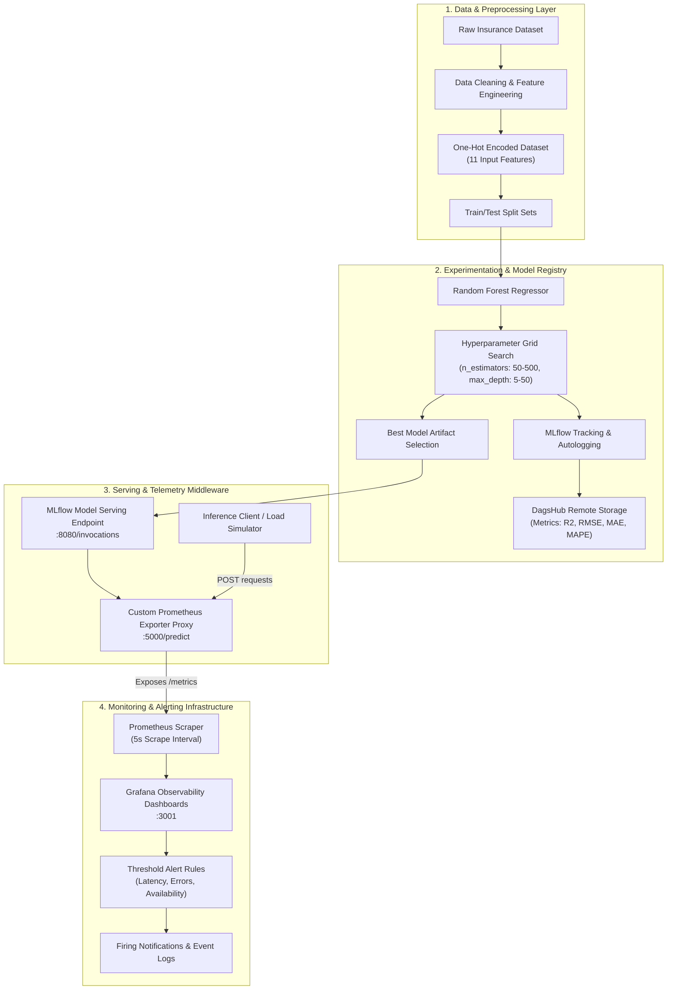

# 🏥 Production-Grade MLOps Pipeline: Medical Insurance Cost Prediction

<div align="center">

### An End-to-End Machine Learning Operations Architecture Featuring Automated Experiment Tracking, Model Serving, Prometheus Metrics Instrumentation, and Real-Time Grafana Observability

[](https://www.python.org/)
[](https://mlflow.org/)
[](https://dagshub.com/jihankusumawwardhani/my-first-repo/experiments)
[](https://scikit-learn.org/)
[](https://prometheus.io/)
[](https://grafana.com/)
[](https://www.docker.com/)
[](https://opensource.org/licenses/MIT)

[](https://www.dicoding.com/)
[](#-project-achievement)
[]()

</div>

---

## 📌 Table of Contents

- [Project Overview](#-project-overview)
- [Key Achievements](#-key-achievements)
- [System Architecture](#-system-architecture)
- [Core Features & Technical Scope](#-core-features--technical-scope)
- [Prometheus Telemetry & Metrics Catalog](#-prometheus-telemetry--metrics-catalog)
- [Repository Structure](#-repository-structure)
- [Visual Evidence & Dashboards](#-visual-evidence--dashboards)
- [Getting Started & Reproduction Guide](#-getting-started--reproduction-guide)
  - [1. Prerequisites](#1-prerequisites)
  - [2. Installation](#2-installation)
  - [3. Model Training & Experiment Tracking](#3-model-training--experiment-tracking)
  - [4. Model Serving & Prometheus Exporter](#4-model-serving--prometheus-exporter)
  - [5. Monitoring & Dashboard Setup](#5-monitoring--dashboard-setup)
  - [6. Inference Simulation & Load Testing](#6-inference-simulation--load-testing)
- [CI/CD & Remote Artifact Repositories](#-cicd--remote-artifact-repositories)
- [Author & Acknowledgments](#-author--acknowledgments)
- [License](#-license)

---

## 📖 Project Overview

This repository demonstrates a production-grade, end-to-end **Machine Learning Operations (MLOps)** pipeline designed for medical insurance cost prediction. Developed as the final capstone project for the Dicoding program **"Membangun Sistem Machine Learning" (Building Machine Learning Systems)**, this system bridges the gap between machine learning experimentation and operational production readiness.

### The Problem
Healthcare insurance providers require reliable estimation of patient risk charges based on demographic and lifestyle indicators (*age, BMI, smoking status, family dependencies, and geographical region*). In traditional setups, ML models remain static notebooks prone to model degradation, undetected service failures, and unmonitored inference latency.

### The Solution
This project implements a mature MLOps workflow addressing the full lifecycle:
- **Reproducible Data Pipeline:** Feature preparation and encoding of multi-attribute tabular medical data.
- **Systematic Experiment Tracking:** Hyperparameter search logging metrics ($R^2$, RMSE, MSE, MAE, MAPE) locally and remotely synced with **MLflow** and **DagsHub**.
- **Model Registry & Serving:** Deploying optimized Random Forest Regressor models via REST microservices.
- **Enterprise-Grade Observability:** A custom telemetry exporter providing 10+ real-time Prometheus metrics with Grafana visualization.
- **Automated Alerting Engine:** Threshold-based alerts detecting service timeouts, error spikes, and latency degradation.

---

## 🏆 Key Achievements

This capstone project successfully passed all **Advanced Criteria** requirements with the highest possible score:

<div align="center">

### ⭐ Score: 5.0 / 5.0 (All Advanced Criteria Fulfilled)


</div>

> **Reviewer Assessment Highlights:**
> - Complete and structured end-to-end pipeline implementation from modeling to production observability.
> - Full autologging and manual hyperparameter logging via MLflow & DagsHub remote tracking.
> - Robust custom Prometheus Exporter delivering rich application and model inference metrics.
> - Fully configured Grafana dashboards with comprehensive panels and operational alert rules.

---

## 🏛 System Architecture

The following diagram illustrates the complete data, training, serving, and telemetry lifecycle:



---

## ✨ Core Features & Technical Scope

### 1. Data Engineering & Preprocessing
- Structured ingestion of customer insurance data.
- Feature transformation pipelines including one-hot encoding for categorical variables (`sex`, `smoker`, `region`).
- Feature scaling and validation ensuring strict schema compatibility with the inference model.

### 2. Model Development & Hyperparameter Tuning
- **Algorithm:** Random Forest Regressor (`RandomForestRegressor`).
- **Optimization Strategy:** Multi-dimensional parameter grid exploration across tree depth (`max_depth`) and ensemble estimator count (`n_estimators`).
- **Comprehensive Evaluation:** Automated logging of 5 evaluation metrics:
  - Coefficient of Determination ($R^2$)
  - Root Mean Squared Error (RMSE)
  - Mean Squared Error (MSE)
  - Mean Absolute Error (MAE)
  - Mean Absolute Percentage Error (MAPE)
- **Artifact Management:** Logging input examples, model signatures, parameters, and serialized best models to the MLflow Model Registry.

### 3. Model Serving & Middleware Architecture
- Microservice proxy built with Flask acting as an API gateway for MLflow model serving.
- Handles input validation, request routing, response sanitization, and structured error handling.
- Graceful degradation with distinct error categorization (`invalid_input`, `model_error`, `timeout`, `connection_error`).

### 4. Real-Time Telemetry & Monitoring
- Sub-second Prometheus scraping configuration (`scrape_interval: 5s`).
- Rich multi-panel Grafana dashboard tracking request velocity, P50/P95/P99 latency distribution, error frequency, and model uptime.

### 5. Automated Alerting System
- 3 proactive Grafana alerting rules:
  1. **High Latency Alert:** Triggers when prediction latency exceeds operational SLA thresholds.
  2. **Error Rate Spike Alert:** Fires when the ratio of HTTP 4xx/5xx errors exceeds safety boundaries.
  3. **Service Downtime Alert:** Instantly notifies operators when model health endpoints stop responding.

---

## 📊 Prometheus Telemetry & Metrics Catalog

The custom Prometheus Exporter (`prometheus_exporter.py`) instruments the prediction pipeline with 10 dedicated metrics:

| Metric Identifier | Metric Type | Labels / Buckets | Description |
|:---|:---:|:---|:---|
| `prediction_requests_total` | **Counter** | `method`, `endpoint` | Total count of all incoming prediction requests received. |
| `prediction_duration_seconds` | **Histogram** | `[0.1, 0.25, 0.5, 0.75, 1.0, 2.5, 5.0, 7.5, 10.0]` | Latency distribution of prediction requests, enabling P50, P95, and P99 monitoring. |
| `prediction_errors_total` | **Counter** | `error_type` (`invalid_input`, `model_error`, `timeout`, `connection_error`, `unknown`) | Total number of prediction errors segmented by root cause. |
| `active_requests` | **Gauge** | — | Real-time gauge tracking active concurrent requests currently being processed. |
| `successful_predictions` | **Counter** | — | Total count of successfully executed inferences returning HTTP 200. |
| `failed_predictions` | **Counter** | — | Total count of failed inference attempts across all failure modes. |
| `input_validation_errors` | **Counter** | — | Tracks malformed, empty, or schema-invalid input payloads. |
| `model_uptime_seconds` | **Gauge** | — | Total elapsed seconds since the inference proxy service started. |
| `predictions_by_status` | **Counter** | `status` | Distribution of prediction outcomes grouped by predicted cost bracket. |
| `request_size_bytes` | **Histogram** | `[100, 500, 1000, 5000, 10000]` | Request payload size in bytes to monitor network throughput patterns. |

---

## 📂 Repository Structure

```plaintext
end-to-end-mlops-pipeline-2025/
│
├── Membangun Model/                             # Phase 1: Machine Learning Development
│   ├── insurance_preprocessing/                 # Preprocessed train & test datasets
│   │   ├── insurance_train_preprocessed.csv
│   │   └── insurance_test_preprocessed.csv
│   ├── modelling.py                             # Baseline Random Forest model training & MLflow autolog
│   ├── modelling_tuning.py                      # Hyperparameter tuning, multi-metric logging & DagsHub sync
│   ├── requirements.txt                         # Python dependencies for model training
│   ├── dagshub.txt                              # DagsHub remote tracking URI reference
│   ├── screenshoot_dashboard.jpg.png            # Visual proof: MLflow experiment tracking dashboard
│   └── screenshoot_artifak.jpg.png              # Visual proof: MLflow registered model artifacts
│
├── Monitoring dan Logging/                      # Phase 2: Production Serving & Observability
│   ├── 1. bukti_serving.png                     # Evidence: Model serving running locally
│   ├── 2. prometheus.yml.yml                    # Prometheus scraper configuration (5s interval)
│   ├── 3. prometheus_exporter.py.py             # Custom Flask Prometheus exporter (10+ custom metrics)
│   ├── 7. inference.py.py                       # Automated test simulation (valid & chaos load test)
│   ├── 4. bukti monitoring prometheus/          # Evidence: Prometheus metrics endpoint & target health
│   │   └── monitoring prometheus.png
│   ├── 5. bukti monitoring Grafana/             # Evidence: Grafana real-time metrics dashboard
│   │   └── monitoring grafana.png
│   └── 6. bukti alerting Grafana/               # Evidence: Grafana alert rules & triggered alerts
│       ├── rules alert 1 grafana.png
│       ├── rules alert 2 grafana.png
│       ├── rules alert 3 grafana.png
│       ├── notifikasi alert 1 grafana.png
│       ├── notifikasi alert 2 grafana.png
│       └── notifikasi alert 3 grafana.png
│
├── Workflow-CI.txt.txt                          # Reference link to GitHub Actions CI repository
├── Eksperimen_SML_Jihan-Kusumawardani.txt.txt   # Reference link to remote SML experiment repository
└── README.md                                    # Comprehensive project documentation
```

---

## 📸 Visual Evidence & Dashboards

<details>
<summary><b>🔍 1. MLflow & DagsHub Experiment Tracking</b> <i>(Click to expand)</i></summary>

### Hyperparameter Search & Experiment Comparison
MLflow tracks all iterations across varying `n_estimators` and `max_depth` parameters, logging $R^2$, RMSE, MSE, MAE, and MAPE.


### Model Registry & Artifact Management
The best performing model candidate is serialized and logged with full input examples and environment signatures.


</details>

<details>
<summary><b>🔍 2. Model Serving & Prometheus Scraping</b> <i>(Click to expand)</i></summary>

### Model Serving Invocations
Serving verification showing successful prediction endpoints handling requests.


### Prometheus Target & Metrics Collection
Prometheus actively scrapes metrics from the custom exporter at `/metrics` every 5 seconds.


</details>

<details>
<summary><b>🔍 3. Grafana Observability Dashboard</b> <i>(Click to expand)</i></summary>

### Live Grafana Dashboard
Visualizes inference volume, latency histograms, successful vs. failed predictions, active requests, and error breakdown.


</details>

<details>
<summary><b>🔍 4. Grafana Alert Rules & Firing Notifications</b> <i>(Click to expand)</i></summary>

### Configured Alert Rules
Three alert rules established with threshold evaluation queries for latency, error rate spikes, and availability:

| Rule Name | Visual Reference |
|:---|:---:|
| **Alert Rule 1: High Latency** |  |
| **Alert Rule 2: Error Rate Threshold** |  |
| **Alert Rule 3: Service Health / Downtime** |  |

### Firing Alert Notifications
Proof of alert evaluations triggering state transitions upon injected chaos testing:

| Notification 1 | Notification 2 | Notification 3 |
|:---:|:---:|:---:|
|  |  |  |

</details>

---

## 🚀 Getting Started & Reproduction Guide

### 1. Prerequisites
- **Python:** Version `3.10` or higher
- **Docker & Docker Compose:** For running Prometheus and Grafana
- **Git:** Version control

### 2. Installation

Clone this repository and create an isolated virtual environment:

```bash
# Clone the repository
git clone https://github.com/jihanbuildspace/end-to-end-mlops-pipeline-2025.git
cd end-to-end-mlops-pipeline-2025

# Create and activate virtual environment
# Windows:
python -m venv venv
venv\Scripts\activate

# Linux / macOS:
python3 -m venv venv
source venv/bin/activate
```

Install training dependencies:

```bash
pip install -r "Membangun Model/requirements.txt"
pip install flask prometheus-client requests
```

---

### 3. Model Training & Experiment Tracking

#### A. Run Baseline Training
To execute the baseline Random Forest model with MLflow autologging:

```bash
# Optional: Launch local MLflow UI in a separate terminal
mlflow ui --port 5000

# Run baseline modeling script
cd "Membangun Model"
python modelling.py
```

#### B. Run Hyperparameter Tuning with DagsHub
To run systematic grid search tuning and sync experiment logs to DagsHub:

```bash
python modelling_tuning.py
```

*The script iterates across `n_estimators` (50–500) and `max_depth` (5–50), logging metrics and exporting the best model candidate.*

---

### 4. Model Serving & Prometheus Exporter

#### A. Serve the MLflow Model
Serve the trained artifact using MLflow serving (runs on port 8080):

```bash
mlflow models serve -m "Membangun Model/mlruns/<experiment_id>/<run_id>/artifacts/best_model" -p 8080 --no-conda
```

#### B. Start the Prometheus Exporter Proxy
Launch the telemetry proxy which instruments incoming requests and forwards predictions to the MLflow model (runs on port 5000):

```bash
cd "Monitoring dan Logging"
python "3. prometheus_exporter.py.py"
```

Verify service endpoints:
- **Prediction Endpoint:** `http://localhost:5000/predict` (POST)
- **Prometheus Metrics:** `http://localhost:5000/metrics` (GET)
- **Health Check:** `http://localhost:5000/health` (GET)

---

### 5. Monitoring & Dashboard Setup

Start Prometheus and Grafana using Docker:

#### A. Prometheus Configuration
Ensure `Monitoring dan Logging/2. prometheus.yml.yml` is mounted to Prometheus:

```yaml
global:
  scrape_interval: 5s
  evaluation_interval: 5s

scrape_configs:
  - job_name: 'model-serving'
    static_configs:
      - targets: ['host.docker.internal:5000']
    metrics_path: '/metrics'
```

Run Prometheus container:
```bash
docker run -d --name prometheus -p 9090:9090 -v "$(pwd)/Monitoring dan Logging/2. prometheus.yml.yml:/etc/prometheus/prometheus.yml" prom/prometheus
```

#### B. Launch Grafana
```bash
docker run -d --name grafana -p 3001:3000 grafana/grafana
```

Access Grafana at `http://localhost:3001` (Default login: `admin` / `admin`):
1. Add **Prometheus** as a data source (`http://host.docker.internal:9090` or `http://localhost:9090`).
2. Import or create panels for:
   - Request Rate: `rate(prediction_requests_total[1m])`
   - Latency Percentile P95: `histogram_quantile(0.95, sum(rate(prediction_duration_seconds_bucket[1m])) by (le))`
   - Error Rate: `sum(rate(prediction_errors_total[1m]))`
   - Active Requests: `active_requests`

---

### 6. Inference Simulation & Load Testing

To simulate realistic production traffic and test the alerting system, execute the load simulation script:

```bash
cd "Monitoring dan Logging"
python "7. inference.py.py"
```

The script automatically executes:
- **50 Valid Requests:** Real insurance profiles to record accurate latency and success metrics.
- **10 Invalid / Malformed Payloads:** Chaos injection (empty bodies, invalid feature counts) to trigger validation error counters and Grafana alerts.

---

## 🔗 CI/CD & Remote Artifact Repositories

| Component | Target Location / Repository Link | Purpose |
|:---|:---|:---|
| **Continuous Integration (CI)** | [Workflow-CI Repository](https://github.com/jihankusumaww/Workflow-CI) | Automated linting, unit testing, and workflow execution via GitHub Actions |
| **Remote SML Experiments** | [Eksperimen_SML Repository](https://github.com/jihankusumaww/Eksperimen_SML_Jihan-Kusumawardani) | Version-controlled experiment codebase and tracking scripts |
| **Cloud Experiment Tracking** | [DagsHub Experiments Board](https://dagshub.com/jihankusumawwardhani/my-first-repo/experiments) | Centralized metrics, model comparisons, and run artifact inspection |

---

## 👨‍💻 Author & Acknowledgments

**Jihan Kusumawardhani**  
*Informatics Engineering Graduate | AI & MLOps Enthusiast*

- 🌐 **GitHub:** [@jihanbuildspace](https://github.com/jihanbuildspace) / [@jihankusumaww](https://github.com/jihankusumaww)
- 💼 **Focus Areas:** Machine Learning Operations (MLOps), Cloud & Backend Systems, Data-Driven Applications

Special thanks to **Dicoding Indonesia** and the instructional team of *"Membangun Sistem Machine Learning"* for the curriculum and rigorous review standards.

---

## 📄 License

This project is open-source software licensed under the [MIT License](LICENSE). Feel free to use, modify, and distribute this codebase for educational and research purposes.
